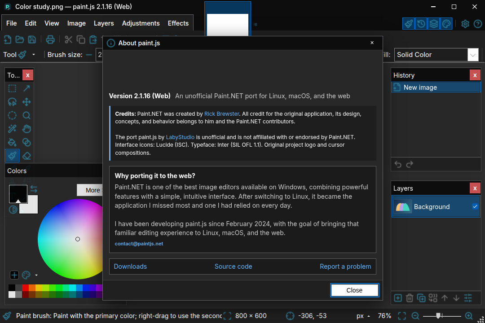
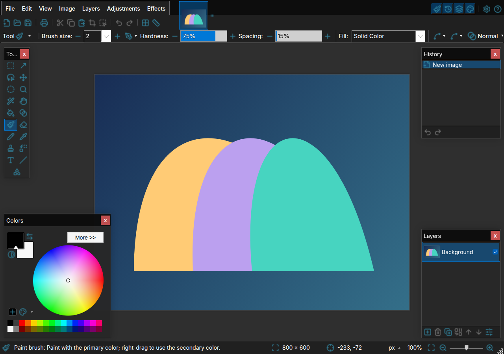

### Disclaimer
I've used Paint.NET for years while daily driving Windows. After switching to Linux, it's been a hole that I simply couldn't fill with other software, and been considering vibecoding it from scratch for a while. After stumbiling upon LabyStudio's port, I've decided to use it as a base and vibecode further. While it's not perfect, I don't expect it to be, and am deeply grateful to LabyStudio for creating it.

This is a fork that I maintain on my own. Feel free to use it. Please keep in mind that all the code that differs from original LabyStudio's project, is entirely vibecoded. Don't hesitate to open tickets for bugs/feature requests, I'll try to help. Main target is Linux, especially Ubuntu 24.04+.

I mean no harm and did my best to ensure no copyright violations and to credit all the authors & licenses. Though if you're an author and notice any violations, please let me know via an issue or mail dan.devmail@proton.me.


**paint.js** is an unofficial, proof-of-concept, cross-platform **JavaScript** port of the Windows only
raster graphics editor **Paint.NET** by [Rick Brewster](https://www.getpaint.net/). This port is
available for the web and as an Electron desktop application.

Its core editing model is based on **Paint.NET 3.36.7**, the last version released under the original
MIT-compatible license, while the current interface and behavior follow Paint.NET v5.1.12+.

## Why?

Paint.NET is one of the best image editors available on Windows, combining powerful features with a simple, intuitive interface.
After switching to Linux, it became the application I missed most and one I had relied on every day.
I have been developing [paint.js](https://github.com/LabyStudio/paintdotjs) since February 2024, with the goal of bringing that familiar editing experience to Linux, macOS, and the web.

[](LICENSE.md)





## Installation

This fork publishes Linux x86_64 builds on
[GitHub Releases](https://github.com/DanielChydz/paintdotjs/releases/latest).
Download the format for your system:

- **AppImage:** make the downloaded file executable and run it.
- **Ubuntu 24.04 or newer:** install the `.deb` with `sudo apt install ./paintdotjs-*.deb`.
- **Fedora and other RPM distributions:** install the `.rpm` with your package manager,
  for example `sudo dnf install ./paintdotjs-*.rpm` on Fedora.
- **Flatpak:** install the bundle with `flatpak install --user ./paintdotjs-*.flatpak`.
  The required Freedesktop runtime comes from Flathub.

Interface artwork and fonts are bundled locally; no Paint.NET download is used.
This fork does not publish macOS builds or an AUR package, and automatic GitHub
Pages deployment is disabled. Application updates use this fork's GitHub releases.

## Differences from Paint.NET

paint.js is largely feature-complete and closely reproduces the Paint.NET experience, but there are
still some additions and limitations worth noting.

### Added in paint.js

- Runs on macOS, Linux, Windows, and the web through a shared JavaScript codebase, with an Electron
  desktop application for a more native experience.
- A **Fonts** settings page lets you add font files by picker or drag and drop, preview installed
  fonts, and remove individual fonts or clear them all. Added fonts are stored locally and are
  available in the Text tool.
- A **Keyboard** settings page lets you rebind, clear, and reset keyboard shortcuts.
- A versioned **JavaScript plugin API** lets extensions add effects, adjustments, and file formats.
- Native **Paint.NET custom shapes** can be installed as `.xaml` files and appear in the Shapes
  tool's Custom category; see [the custom-shapes guide](docs/shapes.md).
- An **icon pack API** can replace icons, images, cursors, and translations without modifying the
  application.
- Interface, canvas, tool, pen, window, and dialog preferences are stored locally and restored across
  sessions.
- **File → Open Recent** remembers the last ten documents, removes duplicates, and lets you clear
  the list. Desktop entries retain file paths; browser entries retain file-system handles and may
  request permission again. Files opened or downloaded without a reusable handle are not listed.
- **Help → Plugins** opens plugin settings. Moving and rotating use bundled original cursors;
  final transforms on large images display a busy dialog before processing and block concurrent input.
- Failed history operations report the error and restore the document and its history
  when recovery is possible; operating-system process termination cannot be recovered.
- Moving a selection briefly fades its white outline back in; disabling **Settings → User Interface →
  Animations** keeps it static and fully visible.
- Window resizing preserves the document center at a fixed zoom, or refits and centers
  **Fit to Window** views.
- The deployed web version can work offline and provides browser-oriented file, clipboard, and drag
  and drop workflows.
- **File → From Camera** requests video access only after **Start Camera**,
  displays a live preview and opens **Take Photo** as an unsaved PNG document.
  Cancel, Escape, closing the dialog, page exit and device failure release the
  stream, including permission granted after cancellation. Permission denial,
  missing/busy cameras and capture failures are displayed in the dialog.
  Supported in Chromium over HTTPS/localhost and desktop installations with
  camera access. System privacy controls still apply; the Flatpak sandbox may
  prevent direct webcam access. The application does not broaden sandbox device
  permissions or request audio.

**Settings → Updates → Automatically check for updates** is persistent. On desktop it controls
startup and hourly checks; **Check now** remains available. In the web app it controls application
update checks and prompts. The browser may independently check its service worker for updates;
disabling the preference keeps offline support intact.

**Settings → Graphics → Use hardware acceleration** is available on desktop.
The preference is saved for the next Electron launch; changing it requires
closing and restarting the application. The page reports the current process
acceleration and Chromium feature statuses separately from the preference.
It does not select a physical GPU. In the browser the switch remains disabled;
WebGL availability alone is not proof of hardware acceleration.

### Missing or limited compared with Paint.NET

- Chromium is the supported browser family. Firefox and Safari are not regularly tested, and their
  file-system and clipboard capabilities differ.
- Scanner acquisition is not implemented yet. ICC support uses an 8-bit sRGB working space; wide-gamut editing and soft proofing are not implemented.
- Native Paint.NET DLL plugins cannot be loaded. JavaScript plugins can provide effects and file types; see [the plugin guide](docs/plugin-api/README.md).
- Manual GPU/device selection and direct advanced-color management are not implemented.
- Very large documents, large-radius effects, and complex selections may still be slower or more
  memory-intensive than in Paint.NET.
- Some browser functionality requires HTTPS or localhost, including parts of the clipboard,
  file-system, and offline-app support.

## Image formats

| Format | Paint.NET open | Paint.NET save | paint.js open | paint.js save | Important differences |
| --- | :---: | :---: | :---: | :---: | --- |
| Paint.NET (`.pdn`) | Yes | Yes | Limited | Limited | Bitmap layers, blend modes and document/layer string metadata are preserved. Saving supports up to 65,535 layers, subject to available memory. History, selections and newer non-bitmap structures are not preserved; see [PDN support](docs/pdn-format.md). |
| PNG | Yes | Yes | Yes | Yes | — |
| JPEG (`.jpg`, `.jpeg`, `.jpe`) | Yes | Yes | Yes | Yes | — |
| JPEG XL (`.jxl`) | Yes | Yes | Yes | Yes | — |
| AVIF | Yes | Yes | Yes | Yes | — |
| HEIC/HEIF | With the Windows codec | With the Windows codec | Yes | Yes | Bundled libheif/Kvazaar saves 8-bit HEVC 4:2:0 images with alpha. RGB conversion and chroma subsampling can change colors even at quality 100. |
| WebP | Yes | Yes | Yes | Yes | — |
| DDS | Yes | Yes | Yes | Yes | Saves uncompressed RGBA or lossy BC1/DXT1 (RGB over white) and BC3/DXT5 (RGBA), without mipmaps. RGBA/BGRA 32-bit DDS is decoded directly, including older paint.js files; other variants use the bundled codec. |
| TIFF (`.tif`, `.tiff`) | Yes | Yes | Yes | Yes | Saves 8-bit/channel RGB or RGBA, uncompressed, LZW or Deflate. RGB composites transparency onto white; RGBA retains alpha. |
| GIF | Yes | Yes | Yes | Yes | paint.js saves a single static, palette-based image only. |
| BMP | Yes | Yes | Yes | Yes | Saves 32-bit with alpha or 24-bit RGB over white. |
| TGA | Yes | Yes | Yes | Yes | Saves uncompressed 32-bit with alpha or 24-bit RGB over white. |
| JPEG XR (`.jxr`, `.wdp`, `.wmp`) | Yes | Yes | Limited | Yes | Opens gray/bilevel, RGB/BGR, packed RGB555/565/10-bit, integer/fixed/half/float, RGBE and CMYK(A). Converts to 8-bit SDR; CMYK uses an unprofiled fallback. Arbitrary N-channel models are unsupported. Saves 8-bit RGBA with lossless alpha; quality 100 preserves RGB exactly. See [codec details](docs/image-encoders.md#jpeg-xr-decoding). |

Animated and multi-page files are imported and exported as a single static image in paint.js.

Embedded ICC profiles in supported raster formats are converted to the sRGB
working space on import. **Image → Color Profile** shows the source/export
profile and lets you choose an RGB ICC export profile. Supported exports convert
the pixels and embed that profile; PDN retains the profile settings. See
[color management](docs/color-management.md) for formats and limitations.

## Icon Packs

This fork uses the new upstream paint.js icon pack because
[we cannot redistribute the original Paint.NET icons](https://github.com/LabyStudio/paintdotjs/issues/5).
You can install and activate custom icon packs from **Settings → Icon Packs** to
replace the default icons or add translations.
See [`docs/asset-packs.md`](docs/asset-packs.md) for the pack format.

## Plugin API

paint.js has a versioned JavaScript API for extensions that add effects, adjustments, or import and
export formats. Plugins can include their own icons and other assets, use built-in
configuration controls, and process either individual pixels or complete images.

Plugins are distributed as `.paintjs` packages. Install them from **Settings → Plugins** using the
plugin browser, file picker, or drag and drop. Start with the step-by-step
[plugin API guide](docs/plugin-api/README.md) to build and package a plugin.

Maintained plugins live in the separate
[`paintdotjs-plugins`](https://github.com/LabyStudio/paintdotjs-plugins) repository. Its build creates
the plugin packages and catalog consumed by the in-app plugin browser.

## Development

Development requires Node.js 22.13.0 or newer; Node.js 24 LTS is recommended. Install the dependencies first:

```bash
npm ci
```

### Run the web version

Run the development build in watch mode:

```bash
npm run web-watch
```

In a second terminal, start a local web server and open <http://127.0.0.1:8773/>:

```bash
npx http-server . -p 8773
```

Do not open `index.html` directly from the filesystem because browser security restrictions disable
required functionality.

### Run the Electron app

```bash
npm run app
```

The application ships the upstream paint.js interface icons and cursors locally.
Inter uses SIL OFL 1.1. The web mark and English labels were created for this fork.
The desktop application logo is by [TetratheBecherovka](https://github.com/TetratheBecherovka),
who shared it in [upstream issue #7](https://github.com/LabyStudio/paintdotjs/issues/7).
See [artwork/SOURCES.md](artwork/SOURCES.md) and [NOTICE.md](NOTICE.md) for credits and provenance.
Neither builds nor first launch download Paint.NET artwork, fonts or translations.
`npm run check-assets` only verifies the bundled files and their hashes.
Only the independently authored English interface dictionary currently ships.

### Build an Ubuntu package

On Linux, build a `.deb` package for Ubuntu 24.04 or newer and the host architecture:

```bash
npm run dist:deb
```

The package is written to `dist/paintdotjs-<version>-linux-<arch>.deb` and includes
Electron, the application, and its required assets. Node.js and npm are only needed
to build the package, not to run the installed application.

On an x86_64 Ubuntu 24.04 or newer system, install the package with:

```bash
sudo apt install ./dist/paintdotjs-*-linux-amd64.deb
```

APT installs the required system libraries, including Ubuntu's `t64` packages.
`npm run dist:linux` continues to build only the AppImage.
To build an RPM locally, install the `rpm` tooling and run `npm run dist:rpm`.

Windows Pen & Ink and display-settings links are disabled outside the Windows
desktop app; they do not offer unsupported `ms-settings:` actions on Ubuntu.

Desktop packages keep the emitted codec chunks and WASM, but omit the duplicate
npm codec copies and development-only project files. Release webpack bundles
do not include eval-based source maps; `npm run web-watch` retains them for debugging.

### GitHub releases

Prepare version changes on `develop`, including `package-lock.json`, then merge
into `master`. A version change in `package.json` triggers the release workflow;
it can also be started manually from Actions for an unreleased version.
The Linux job requires 100% coverage for lines, branches, functions and statements,
then builds AppImage, DEB and RPM packages. The release also includes a Flatpak
bundle. Publishing uses the workflow's `GITHUB_TOKEN` with `contents: write`;
Apple signing credentials and AUR credentials are not needed.

### Testing

Build the bundles before running tests on a fresh checkout:

```bash
npm run desktop:build
npm test
```

For focused effect or desktop checks, use `npm run test:effects` or
`npm run test:desktop` after building. Tests cover the editing engine, file formats,
storage, desktop integration and browser behavior.

### Tests and runtime coverage

On Linux, the desktop tests require `xvfb-run`, FFmpeg (independent image export
decoding), and the system libraries needed by Electron. Use Node.js 24 LTS for
the following commands:

```bash
npm run test:coverage
npm run test:coverage:check
```

The coverage command builds source-mapped test bundles, runs all tests, and writes
an HTML report to `coverage/index.html` and machine-readable reports to `coverage/`.
It includes **every first-party runtime JavaScript file**, including files that
were never executed: `js/`, `src/`, and the desktop runtime helpers
`scripts/asset_archive.js`, `scripts/install_desktop_assets.js`, and
`scripts/resource/ResourceReader.js`, and `scripts/resource/AssetCatalog.js`. It verifies that no source file disappeared
from the report.

Coverage combines Node.js, VM-loaded engine code, the real Electron renderer, and
the Node-disabled browser renderer and effect workers. Worker coverage is collected before termination and mapped back
to the original effect engine. Bundled source maps map codec coverage back to
`src/`; third-party libraries and native/WASM internals are not included in these
JavaScript percentages.

`test:coverage:check` requires **100% lines and 100% branches** and deliberately
fails while either target is unmet. Passing the test suite alone does not imply
100% coverage. Build and release wrappers are outside this runtime threshold;
validate them with the existing lint, asset/version/header checks and package
builds.

`npm test` runs the same tests without collecting coverage; build the bundles first
with `npm run desktop:build` on a fresh checkout. Coverage builds are for testing
only: normal app/package commands rebuild the release bundles without source maps.

### Desktop security

Document layer names are displayed as plain text, not HTML. Keep Electron and the
bundled image codecs updated: Ubuntu system updates do not replace these embedded
runtimes. The current desktop bridge still uses a Node-enabled renderer; migrating
it to a sandboxed, context-isolated preload API is a separate hardening task.

### Build the Flatpak

The Flatpak manifest is in [`flatpak/net.paintjs.Paintjs.yml`](flatpak/net.paintjs.Paintjs.yml).
It builds the checked-out paint.js source with pinned dependencies, bundles the assets needed for
offline use, and keeps the application inside the Flatpak sandbox.

```bash
flatpak-builder --user --install --force-clean \
  --install-deps-from=flathub flatpak-build flatpak/net.paintjs.Paintjs.yml
flatpak run net.paintjs.Paintjs
```

## License

paint.js is licensed under the [MIT License](LICENSE.md). See the
[attribution notice](NOTICE.md) for details about Paint.NET and the JavaScript port.

Large-document measurements and the reproducible benchmark are described in
[large-documents.md](docs/large-documents.md).
